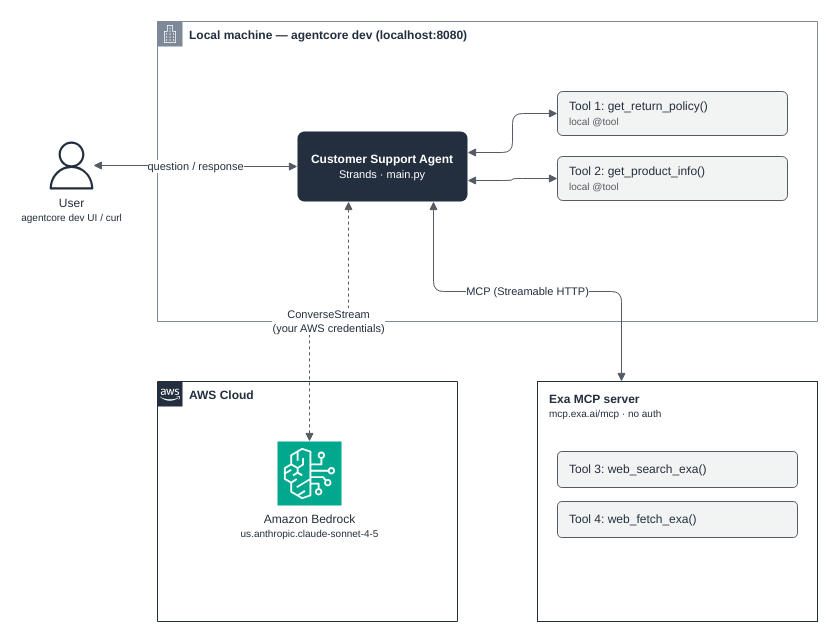
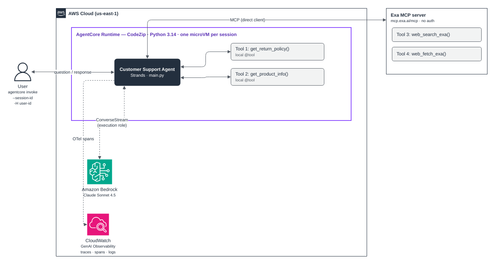
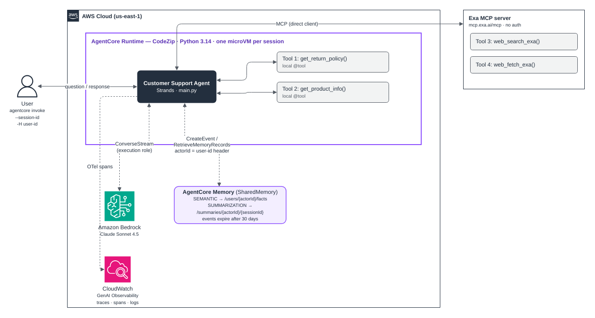
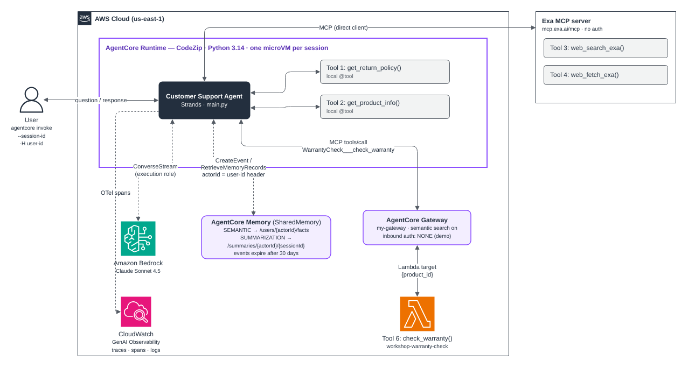

# AgentCore Project

This project was created with the [AgentCore CLI](https://github.com/aws/agentcore-cli).

## Project Structure

```
my-project/
├── AGENTS.md               # AI coding assistant context
├── agentcore/
│   ├── agentcore.json      # Project config (agents, memories, credentials, gateways, evaluators)
│   ├── aws-targets.json    # Deployment targets (account + region)
│   ├── .env.local          # Secrets — API keys (gitignored)
│   ├── .llm-context/       # TypeScript type definitions for AI assistants
│   │   ├── agentcore.ts    # AgentCoreProjectSpec types
│   │   └── aws-targets.ts  # Deployment target types
│   └── cdk/                # CDK infrastructure (@aws/agentcore-cdk)
├── app/                    # Agent application code
└── evaluators/             # Custom evaluator code (if any)
```

## Getting Started

### Prerequisites

- **Node.js** 20.x or later
- **Python 3.10+** and **uv** for Python agents ([install uv](https://docs.astral.sh/uv/getting-started/installation/))
- **AWS credentials** configured (`aws configure` or environment variables)
- **Docker** (only for Container build agents)

### Development

Run your agent locally:

```bash
agentcore dev
```

### Validate Invocation Input

Validate runtime invocation payloads before forwarding them to an agent framework. Keep user prompts typed as strings
and pass only prompt text to the agent.

### Deployment

Deploy to AWS:

```bash
agentcore deploy
```

## Commands

| Command | Description |
| --- | --- |
| `agentcore create` | Create a new AgentCore project |
| `agentcore add` | Add resources (agent, memory, credential, gateway, evaluator, policy) |
| `agentcore remove` | Remove resources |
| `agentcore dev` | Run agent locally with hot-reload |
| `agentcore deploy` | Deploy to AWS via CDK |
| `agentcore status` | Show deployment status |
| `agentcore invoke` | Invoke agent (local or deployed) |
| `agentcore logs` | View agent logs |
| `agentcore traces` | View agent traces |
| `agentcore eval` | Run evaluations |
| `agentcore package` | Package agent artifacts |
| `agentcore validate` | Validate configuration |
| `agentcore pause` | Pause a deployed agent |
| `agentcore resume` | Resume a paused agent |
| `agentcore fetch` | Fetch remote resource definitions |
| `agentcore import` | Import existing resources |
| `agentcore update` | Check for CLI updates |

## Configuration

Edit the JSON files in `agentcore/` to configure your project. See `agentcore/.llm-context/` for type definitions and validation constraints.

The project uses a **flat resource model** — agents, memories, credentials, gateways, evaluators, and policies are top-level arrays in `agentcore.json`. Resources are independent; agents discover memories and credentials at runtime via environment variables or SDK calls.

## Resources

| Resource | Purpose |
| --- | --- |
| Agent (runtime) | HTTP, MCP, or A2A agent deployed to AgentCore Runtime |
| Memory | Persistent context storage with configurable strategies |
| Credential | API key or OAuth credential providers |
| Gateway | MCP gateway that routes tool calls to targets |
| Gateway Target | Tool implementation (Lambda, MCP server, OpenAPI, Smithy, API Gateway) |
| Evaluator | Custom LLM-as-a-Judge or code-based evaluation |
| Online Eval Config | Continuous evaluation pipeline for deployed agents |
| Policy | Cedar authorization policies for gateway tools |

### Agent Types

- **Template agents**: Created from framework templates (Strands, LangChain/LangGraph, GoogleADK, OpenAI Agents, Autogen)
- **BYO agents**: Bring your own code with `agentcore add agent --type byo`
- **Import agents**: Import existing Bedrock agents with `agentcore import`

### Build Types

- **CodeZip**: Python source packaged as a zip and deployed directly to AgentCore Runtime
- **Container**: Docker image built via CodeBuild (ARM64), pushed to ECR, and deployed to AgentCore Runtime

## How I Built It: Workshop Progression

The agent grew stage by stage. Each diagram has an editable draw.io source in `docs/architecture/` (open the `.drawio` file in draw.io or the VS Code Draw.io extension, then re-export the `.png`).

| Stage | What was added | Where it runs |
| --- | --- | --- |
| 1 | Strands agent + 2 local tools + Exa MCP | Local (`agentcore dev`) |
| 2 | Deployed to AgentCore Runtime | AWS |
| 3 | AgentCore Memory (long-term, per user) | AWS |
| 4 | AgentCore Gateway + Lambda tool | AWS |

### Stage 1: Local agent with tools and MCP



- **Agent:** Strands `Agent` in `app/CustomerSupport/main.py`, model set in `model/load.py`.
- **Tools:** `get_return_policy()` and `get_product_info()` as local `@tool` functions; Exa web search via `MCPClient` in `mcp_client/client.py` (`https://mcp.exa.ai/mcp`, no auth).
- **Model:** `us.anthropic.claude-sonnet-4-5-20250929-v1:0`. The workshop's Sonnet 5.5 returned `AccessDeniedException` ("not available for this account"), so I used the newest model enabled on my account. `model/load.py` is the only place to change it.
- **Run:** `agentcore dev` → chat UI on `localhost:8081`, agent on `localhost:8080`.

### Stage 2: Deploy to AgentCore Runtime



- **Deploy:** `agentcore deploy` (CDK, `CodeZip` build, Python 3.14). Same code, now in a managed microVM per session.
- **Invoke:** `agentcore invoke "..." --session-id <uuid>`; reuse the session ID to keep context.
- **Credentials:** locally the agent used my AWS profile; in Runtime it uses the runtime's **execution role** (needs `bedrock:InvokeModel*` on the model / inference profile).
- **Observability:** spans go to CloudWatch (GenAI Observability) with no code change.

### Stage 3: Add AgentCore Memory



- **Config:** `memories: [SharedMemory]` in `agentcore/agentcore.json` with SEMANTIC (`/users/{actorId}/facts`) and SUMMARIZATION (`/summaries/{actorId}/{sessionId}`).
- **Code:** `memory/session.py` builds an `AgentCoreMemorySessionManager`; `main.py` passes it as `session_manager=` (hook pattern).
- **User identity:** `X-Amzn-Bedrock-AgentCore-Runtime-Custom-User-Id` header → `actorId`. Allowlisted via `requestHeaderAllowlist` on the runtime.
- **Test:** `agentcore invoke "..." --session-id %S% -H "X-Amzn-Bedrock-AgentCore-Runtime-Custom-User-Id: Kiran" --stream`, wait ~2 min, ask again from a **new** session.
- See [Memory Strategies](#memory-strategies) for details and the test matrix.

### Stage 4: Add AgentCore Gateway with a Lambda tool



- **Gateway:** `my-gateway` (semantic tool search on, inbound auth `NONE` for the demo).
- **Target:** Lambda `workshop-warranty-check` exposed as `WarrantyCheck___check_warranty`, schema in `app/CustomerSupport/tool/warranty_schema.json`:

```cmd
agentcore add gateway-target --type lambda-function-arn --name WarrantyCheck --lambda-arn arn:aws:lambda:us-east-1:045119972392:function:workshop-warranty-check --tool-schema-file app\CustomerSupport\tool\warranty_schema.json --gateway my-gateway
agentcore deploy
```

- **Flow:** the model emits `{"product_id": "PROD-002"}` → Strands sends MCP `tools/call` to the Gateway → Gateway invokes the Lambda with only those arguments.
- **Kept as-is:** local tools stay in code; Exa stays a direct MCP client.

### One request end to end (from a real trace)

```
User → Runtime (/invocations, 6.98 s)
  ├─ Memory: CreateEvent + RetrieveMemoryRecords x2 (facts, summaries)   ~0.4 s
  ├─ Model call 1 (Sonnet 4.5) → tool_use check_warranty(PROD-002)        1.8 s
  ├─ Gateway → Lambda                                                     0.33 s
  ├─ Model call 2 → final answer (end_turn)                               4.0 s
  └─ Memory: CreateEvent after each step
```

The LLM decides, Strands executes, and memory and tool results are just more context in the LLM's input.

### Windows notes (what I hit)

| Problem | Fix |
| --- | --- |
| `fetch failed` in `agentcore dev` | `set NODE_OPTIONS=--dns-result-order=ipv4first` (Node tries IPv6 `localhost`, agent listens on `127.0.0.1`) |
| `'charmap' codec can't encode character` | `set PYTHONUTF8=1` (emoji in model output) |
| `agentcore dev --no-browser` exits silently in cmd | Use the web UI mode (`agentcore dev`) |
| Bash commands in the workshop | `$(...)` → `for /f %i in ('...') do set VAR=%i`; `$VAR` → `%VAR%`; `\` → `^` or one line; `sleep 2m` → `timeout /t 120` |
| `git add` picked up the venv | `git restore --staged ../myenv/` and add `myenv/` to `.gitignore` |

### Next stages

_To be added as the workshop continues. For each new stage: add `docs/architecture/stageN-<name>.drawio` + `.png` and a short "what changed / config / code / test" block above._

## Sessions, Timeouts, Traces and Spans

### Session vs. trace vs. span

| Term | What it is | Created when |
| --- | --- | --- |
| **Session** | One conversation, identified by a session ID | First invoke with a new (or no) session ID |
| **Trace** | One request/response inside a session | Every invoke |
| **Span** | One timed step inside a trace (model call, tool call, loop cycle) | Every step the agent takes |

A chat with 5 questions is **1 session, 5 traces**, and many spans. All 5 traces carry the same session ID, so they can be grouped by conversation.

### Sessions and microVMs

- In AgentCore Runtime, **each session runs in its own isolated microVM**.
- Invokes with the **same session ID** go to the same microVM, so in-memory state (the cached agent and its `agent.messages` history) carries over.
- A **new session ID** (or none) means a fresh microVM with no memory of earlier calls.
- `agentcore invoke` generates a new session ID on every call unless you pass one:

```bash
agentcore invoke "can you check today's weather in NC 28104"
# output ends with: Session: fa3d162a-ea98-42ee-b314-96392777bd4b

agentcore invoke "what city did I ask about?" --session-id fa3d162a-ea98-42ee-b314-96392777bd4b
# -> remembers Matthews, NC because it's the same session
```

- From boto3, pass the same `runtimeSessionId` to `invoke_agent_runtime`. Session IDs must be **at least 33 characters** (a full UUID works).

### Session timeouts

Both timers apply **per session** (per microVM), not across all sessions. They are configured once on the runtime's `lifecycleConfiguration` and apply to every session it creates.

| Setting | Default | Meaning |
| --- | --- | --- |
| `idleRuntimeSessionTimeout` | 900 s (15 min) | Session ends after this long with no invokes. Each invoke resets the clock. |
| `maxLifetime` | 28800 s (8 h) | Session ends this long after it started, however active it is. |

- Valid range for both: 60–28800 seconds; idle timeout must be ≤ max lifetime.
- Example: session A chatting every 5 minutes from 9:00 ends at 17:00 (max lifetime). Session B sending one message at 9:00 ends around 9:15 (idle). They run independently.
- Reusing a session ID after it ended gives a **fresh microVM** under the same ID; the old in-memory history is gone.

Check what your runtime uses (no output / `null` = defaults):

```bash
aws bedrock-agentcore-control get-agent-runtime --agent-runtime-id <runtime-id> --region us-east-1 --query lifecycleConfiguration
```

### How long does the agent remember?

In-memory conversation history lasts until the first of:

1. The session goes idle past the idle timeout (default 15 min).
2. The session reaches max lifetime (default 8 h).
3. Strands' sliding-window conversation manager drops older messages (about the last 40 messages, including tool calls/results, are kept by default).
4. **Locally:** `agentcore dev` restarts (including after code edits).

For memory that survives new sessions, timeouts or days, use **AgentCore Memory**.

### Traces and spans

Strands emits OpenTelemetry spans automatically. A one-tool question typically produces about 6 spans:

```
invoke_agent CustomerSupport                 <- whole agent run
├── execute_event_loop_cycle  (cycle 1)
│   ├── chat  (model call #1)               <- model decides to call get_return_policy
│   └── execute_tool get_return_policy      <- Python tool runs
└── execute_event_loop_cycle  (cycle 2)
    └── chat  (model call #2)               <- model writes the final answer
```

Exact names and counts vary by Strands/AgentCore version. Useful span details:

- **chat**: model ID, input/output tokens, latency.
- **execute_tool**: tool name, arguments, result, duration.

**Where traces go:**

- **Locally (`agentcore dev`):** the CLI runs a local OTLP receiver and sets `OTEL_*` environment variables on the agent process. Spans stay on your machine and appear in the inspector's **Traces** tab and as the "tool used" / token-count chips in the chat UI.
- **Deployed:** the same spans go to AgentCore Observability (CloudWatch → GenAI Observability / X-Ray). No code changes needed.

Note: the `invoke` entrypoint in `main.py` only yields text (`event["data"]`), so tool calls don't appear in the response stream itself; the UI shows them from the trace data.

## Memory Strategies

Memory is defined in `CustomerSupport/agentcore/agentcore.json` (`SharedMemory`) and wired in via `app/CustomerSupport/memory/session.py`. Deploy injects its ID as `MEMORY_SHAREDMEMORY_ID`; if that env var is missing, the agent runs without memory.

```json
"memories": [{
  "name": "SharedMemory",
  "eventExpiryDuration": 30,
  "strategies": [
    { "type": "SEMANTIC",      "namespaceTemplates": ["/users/{actorId}/facts"] },
    { "type": "SUMMARIZATION", "namespaceTemplates": ["/summaries/{actorId}/{sessionId}"] }
  ]
}]
```

| | Short-term (events) | SEMANTIC | SUMMARIZATION |
| --- | --- | --- | --- |
| Stores | Raw conversation turns | Facts about the user | Summary of one session |
| Scope | Session | **User** (across sessions) | User + session |
| Namespace | n/a | `/users/{actorId}/facts` | `/summaries/{actorId}/{sessionId}` |
| Lifetime | `eventExpiryDuration` = 30 days | Until deleted | Until deleted |
| Example | "My name is Sarah and I prefer email updates. I recently bought a Smart Watch." | `Name is Sarah` · `Prefers email` · `Bought a Smart Watch` | "User introduced herself as Sarah, set email preference, mentioned Smart Watch purchase." |

- **actorId** = the `X-Amzn-Bedrock-AgentCore-Runtime-Custom-User-Id` header (must be in `requestHeaderAllowlist`). **sessionId** = `--session-id`.
- Retrieval (`session.py`): top 3 records per namespace with relevance ≥ 0.3 are added to the agent's context on each turn.
- Long-term extraction is **asynchronous**. Wait ~1–2 minutes before testing recall in a new session.

### Choosing a strategy: SEMANTIC vs USER_PREFERENCE vs EPISODIC

All three run asynchronously on the same conversation events. They differ in **what they extract**.

| | SEMANTIC | USER_PREFERENCE | EPISODIC |
| --- | --- | --- | --- |
| Captures | Facts (entities, events, details) | Likes, choices, style | Episodes: scenario → intent → actions → outcome, plus cross-episode **reflections** |
| Answers | "What do I know?" | "How does this user want things?" | "What worked last time?" |
| Namespace | `/users/{actorId}/facts` | `/users/{actorId}/preferences` | `/strategy/{memoryStrategyId}/actors/{actorId}/sessions/{sessionId}` |
| From the Sarah prompt | `Name is Sarah` · `Bought a Smart Watch` | `Prefers email updates` | "User shared name and purchase; agent confirmed and offered help → resolved" |
| Use for | Order numbers, products owned, case details | Recommendations, tone, contact channel, brands, sizes | Troubleshooting playbooks; learning which fixes succeed |

**When to use which**

- **SEMANTIC:** the agent must recall facts so customers don't repeat themselves. *"Where's order #ABC-123?"* → knows it's the Smart Watch order. The default for support bots.
- **USER_PREFERENCE:** the agent must personalize. *"Recommend headphones"* → suggests a brand the user liked, and replies by email.
- **EPISODIC:** the agent should improve from experience. *"My headphones won't pair"* → reflection says a factory reset fixed this in most past episodes, so it suggests that first.

Today this project uses only SEMANTIC + SUMMARIZATION, so "prefers email" is stored as a **fact**. A good next step for this agent is **SEMANTIC + USER_PREFERENCE + SUMMARIZATION**, adding EPISODIC once it handles multi-step troubleshooting.

To add them (`agentcore.json`, then add the namespaces to `retrieval_config` in `session.py`, then `agentcore deploy`):

```json
{ "type": "USER_PREFERENCE", "namespaceTemplates": ["/users/{actorId}/preferences"] },
{ "type": "EPISODIC",
  "namespaceTemplates": ["/strategy/{memoryStrategyId}/actors/{actorId}/sessions/{sessionId}"],
  "reflectionNamespaceTemplates": ["/strategy/{memoryStrategyId}/actors/{actorId}"] }
```

`reflectionNamespaceTemplates` is required for EPISODIC (see `agentcore/.llm-context/agentcore.ts`).

### Memory patterns: hook vs. tool

- **Session-manager hook** (used here): `session_manager=` in `Agent(...)`. Memory is saved and retrieved **automatically on every turn**; the model has no choice.
- **Memory as a tool**: memory read/write exposed as `@tool` functions. The **model decides** when to look something up or save it.

### Testing it (cmd)

```cmd
for /f %i in ('python -c "import uuid; print(uuid.uuid4())"') do set S1=%i
agentcore invoke "My name is Sarah and I prefer email updates. I recently bought a Smart Watch." --session-id %S1% -H "X-Amzn-Bedrock-AgentCore-Runtime-Custom-User-Id: Kiran" --stream
timeout /t 120

for /f %i in ('python -c "import uuid; print(uuid.uuid4())"') do set S2=%i
agentcore invoke "Do you know anything about me?" --session-id %S2% -H "X-Amzn-Bedrock-AgentCore-Runtime-Custom-User-Id: Kiran" --stream
```

| Test | Session | User ID | Result | Why |
| --- | --- | --- | --- | --- |
| Store | S1 | Kiran | Facts saved | → `/users/Kiran/facts` |
| Recall | **new** S2 | Kiran | "Sarah, email, Smart Watch" | SEMANTIC memory, not chat history |
| Isolation | **new** S3 | Alex | "No information" | Different actorId namespace |
| Wrong ID | **new** S4 | Sarah | "No information" | Facts are keyed by header, not by the name said in chat |
| Gotcha | **same** S2 | K | Still "Sarah" | Cached `_agent` in that microVM is bound to Kiran; header ignored |

**Lessons:** memory is keyed by the **header**, not by what the user says; always use a **new session ID** per test; in production take the user ID from authenticated identity (inbound JWT), not a client-supplied header.

## Documentation

- [AgentCore CLI](https://github.com/aws/agentcore-cli)
- [AgentCore CDK Constructs](https://github.com/aws/agentcore-l3-cdk-constructs)
- [Amazon Bedrock AgentCore](https://aws.amazon.com/bedrock/agentcore/)
